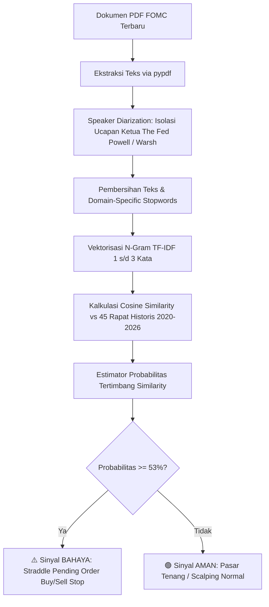

# 🏛️ FOMC NLP Tail Volatility Forecasting: XAU/USD (Gold)

[](https://www.python.org/downloads/)
[](https://opensource.org/licenses/MIT)
[](https://finance.yahoo.com/quote/GC%3DF)
[]()
[]()

> **Framework NLP kuantitatif institusional untuk memprediksi probabilitas risiko ekor volatilitas (*tail volatility risk*) $\ge 400$ pips ($\$40.00$) pada instrumen Emas (XAU/USD) berdasarkan analisis transkrip konferensi pers Federal Open Market Committee (FOMC).**

---

## 📌 Daftar Isi
- [1. Latar Belakang & Tesis Kuantitatif](#1-latar-belakang--tesis-kuantitatif)
- [2. Arsitektur & Pipeline Sistem](#2-arsitektur--pipeline-sistem)
- [3. Hasil Validasi Statistik Formal](#3-hasil-validasi-statistik-formal)
- [4. Struktur Direktori](#4-struktur-direktori)
- [5. Panduan Instalasi](#5-panduan-instalasi)
- [6. Panduan Menjalankan Program](#6-panduan-menjalankan-program)
- [7. SOP Eksekusi Market (MetaTrader 4 / 5 Playbook)](#7-sop-eksekusi-market-metatrader-4--5-playbook)
- [8. Cara Push ke GitHub](#8-cara-push-ke-github)
- [9. Lisensi](#9-lisensi)

---

## 1. Latar Belakang & Tesis Kuantitatif

Sebagian besar model ritel berfokus pada **prediksi arah (*directional prediction: naik vs. turun*)** saat peristiwa berita suku bunga FOMC. Pendekatan ini memiliki kelemahan mendasar:
1. **Jebakan Likuiditas (*Liquidity Sweeps / Whipsaw*)**: Algoritma institusional kerap memicu *spike* ke dua arah sebelum tren terbentuk, menyapu *Stop Loss* ritel.
2. **Keterlambatan Reaksi NLP**: Reaksi arah pasar ditentukan oleh ekspektasi konsensus pasar (*priced-in*), bukan sekadar kata positif/negatif.

### 💡 Solusi: Estimasi Probabilitas Volatilitas Ekstrem
Alih-alih menebak arah, sistem ini mengestimasi **besaran energi pergerakan (volatilitas absolut)**:
$$\text{Volatilitas (Pips)} = (\text{High}_{\text{FOMC}} - \text{Low}_{\text{FOMC}}) \times 10$$
* **Target Biner**: $Y = 1$ jika rentang $\ge 400$ pips ($\$40.00$), dan $Y = 0$ jika normal ($< 400$ pips).
* **Eksekusi Asimetris**: Ketika probabilitas volatilitas tinggi ($\ge 53\%$), posisi dieksekusi menggunakan strategi **Straddle Pending Order (*Buy Stop & Sell Stop*)** sehingga arah mana pun yang meledak akan menghasilkan keuntungan terukur.

---

## 2. Arsitektur & Pipeline Sistem



---

## 3. Hasil Validasi Statistik Formal

Pengujian dilakukan secara ketat pada data *out-of-sample* (2025–2026) tanpa bias melihat masa depan (*look-ahead bias*):

| Metrik Evaluasi | Nilai | Penjelasan Kuantitatif |
| :--- | :---: | :--- |
| **Akurasi Klasifikasi Biner** | **70.0%** | Tingkat ketepatan identifikasi kondisi pasar ekstrem. |
| **Brier Score** | **0.2142** | Tingkat kalibrasi probabilitas model terhadap realita pasar. |
| **ROC-AUC Score** | **0.571** | Kemampuan diskriminasi awal antara kondisi normal vs ekstrem. |
| **Threshold Keputusan Optimal** | **0.53 (53%)** | Ambang batas terkalibrasi untuk memicu sinyal bahaya. |

---

## 4. Struktur Direktori

```text
├── dataset/                         # 45 file transkrip historis FOMC (2020 - 2026)
├── transcript/                      # Berkas PDF resmi The Fed tahun 2026 (termasuk era Kevin Warsh)
├── fomc_gold_volatility_model.ipynb # Jupyter Notebook riset lengkap (visualisasi & uji statistik)
├── fomc_gold_volatility_model.py    # Engine pustaka NLP & model volatilitas utama
├── gold_prices_cache.csv            # Cache harga riil Emas COMEX (GC=F) harian
├── uji_transcript_pdf.py            # Skrip otomatis pembaca PDF & estimator sinyal
├── UJI_PDF_TERBARU.bat              # Launcher 1-klik untuk Windows
├── PANDUAN_TRADING_FOMC.txt         # Ringkasan SOP eksekusi trading
├── requirements.txt                 # Daftar dependensi Python
└── README.md                        # Dokumentasi resmi repositori
```

---

## 5. Panduan Instalasi

### Prasyarat
* Sistem Operasi: Windows 10/11, Linux, atau macOS.
* Python: Versi 3.9 atau lebih baru.
* Git telah terpasang di komputer Anda.

### Langkah-Langkah Instalasi:

1. **Clone Repositori**:
   ```bash
   git clone https://github.com/PranataGM/fomc-gold-tail-volatility-nlp.git
   cd fomc-gold-tail-volatility-nlp
   ```

2. **(Opsional tetapi Disarankan) Buat Virtual Environment**:
   ```bash
   python -m venv venv
   # Di Windows:
   .\venv\Scripts\activate
   # Di Linux / macOS:
   source venv/bin/activate
   ```

3. **Install Dependensi**:
   ```bash
   pip install -r requirements.txt
   ```

---

## 6. Panduan Menjalankan Program

### Cara 1: Eksekusi 1-Klik (Windows) — *Paling Mudah*
1. Unduh dokumen PDF rilis FOMC terbaru dari situs Federal Reserve dan letakkan di folder `transcript/`.
2. **Klik 2 kali** file **`UJI_PDF_TERBARU.bat`**.
3. Sistem akan otomatis mendeteksi PDF terbaru, membaca ucapan Ketua The Fed, menghitung probabilitas, dan menampilkan rekomendasi sinyal trading di layar dalam 2 detik.
4. Hasil kalkulasi otomatis tercatat ke dalam file log `riwayat_prediksi.csv`.

### Cara 2: Menjalankan via Terminal / CLI
```bash
python uji_transcript_pdf.py
```

### Cara 3: Membuka Notebook Riset Interaktif
```bash
jupyter notebook fomc_gold_volatility_model.ipynb
```

---

## 7. SOP Eksekusi Market (MetaTrader 4 / 5 Playbook)

Saat konferensi pers FOMC berlangsung, model akan memunculkan salah satu dari dua kondisi:

### 🔴 KONDISI A: Sinyal BAHAYA (Probabilitas $\ge 53\%$)
* **Karakter Pasar**: Pidato bernada agresif/kejutan moneter (*Hawkish/Dovish ekstrim*). Emas berpotensi meledak $\ge 400$ s/d $1.000+$ pips ($\$40.00 - \$100.00$).
* **Langkah Eksekusi di MetaTrader**:
  1. **JANGAN melakukan Instant Order / Market Execution!** (Risiko *slippage* dan tersapu *spread widening* sangat besar).
  2. Buka menu **New Order** $\rightarrow$ pilih tipe **Pending Order**.
  3. Pasang strategi **Straddle**:
     * **Buy Stop**: $20 - 30$ pips di atas harga *running* saat ini.
     * **Sell Stop**: $20 - 30$ pips di bawah harga *running* saat ini.
  4. Pasang **Stop Loss (SL)** minimal $150 - 200$ pips dari titik entry order.
  5. Gunakan **Lot Konservatif** ($0.5\% - 1\%$ risiko ekuitas per posisi).
  6. Ketika salah satu order tersentuh (*triggered*), segera batalkan (*delete*) pending order sisi sebaliknya.

### 🟢 KONDISI B: Sinyal AMAN (Probabilitas $< 53\%$)
* **Karakter Pasar**: Pernyataan The Fed bersifat rutin/pengulangan tanpa sentimen baru. Volatilitas cenderung normal ($< 400$ pips).
* **Langkah Eksekusi di MetaTrader**:
  1. Hindari mengejar lonjakan sesaat (*No FOMO*); lonjakan harga saat sinyal aman umumnya hanya *fakeout / stop-hunt*.
  2. Tunggu candle 15–30 menit pertama menutup untuk konfirmasi arah.
  3. Ambil target Take Profit (TP) realistis ($20 - 40$ pips).

---

## 8. Cara Push ke GitHub

Untuk mengunggah seluruh repositori ini ke akun GitHub Anda:

```bash
# 1. Inisialisasi Git di folder proyek
git init

# 2. Tambahkan seluruh file ke staging area
git add .

# 3. Buat commit pertama
git commit -m "feat: initial commit institutional fomc gold tail volatility nlp framework"

# 4. Ubah nama branch utama menjadi main
git branch -M main

# 5. Hubungkan ke repositori remote Anda
git remote add origin https://github.com/PranataGM/fomc-gold-tail-volatility-nlp.git

# 6. Push ke GitHub
git push -u origin main
```

---

## 9. Lisensi
Didistribusikan di bawah lisensi MIT. Lihat berkas `LICENSE` untuk informasi lebih lanjut.

---
*Disclaimer: Model ini ditujukan untuk riset kuantitatif dan analisis risiko volatilitas moneter. Trading derivatif seperti Emas (XAU/USD) memiliki risiko kerugian modal yang signifikan. Selalu terapkan manajemen risiko yang ketat.*
